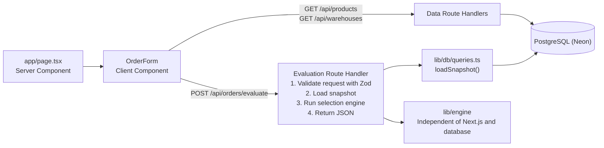
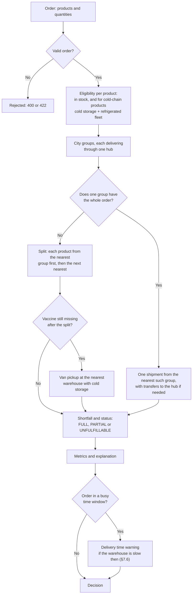
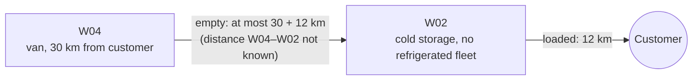
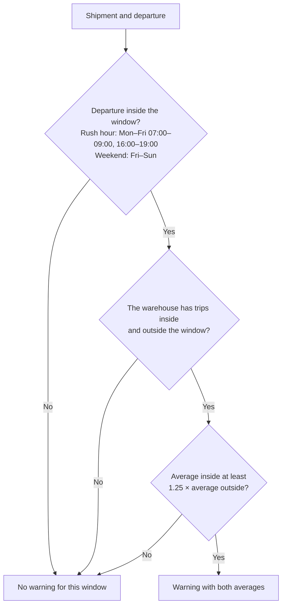

# Technical Design — Warehouse Selection Service

| | |
|---|---|
| **Status** | Draft v0.1 |
| **Date** | 2026-10-17 |
| **Stack** | Next.js (App Router, TypeScript), PostgreSQL, Drizzle ORM, Vercel, Neon |
| **Scope** | Warehouse selection and a simple UI |

---

## 1. Summary

The service selects one or more warehouses to fulfill an order from a hospital, clinic, or pharmacy. It considers product availability, handling requirements, and distance to the customer, then returns the selected warehouses with an explanation of the decision.

The application uses Next.js for both the web UI and API, with PostgreSQL for data storage.

---

## 2. Requirements

### 2.1 Functional requirements

| ID | Requirement | Priority |
|---|---|---|
| F1 | Accept an order containing one or more `{productId, quantity}` lines. | Must |
| F2 | Select warehouses based on stock availability and delivery distance. | Must |
| F3 | Return the selection with an explanation. | Must |
| F4 | Split orders across multiple warehouses when no single warehouse can fulfill the entire order. | Must |
| F5 | Return the best partial result and report the shortfall when available stock cannot cover the entire order. | Must |
| F6 | Provide a UI with an order form and a display of the selection results. | Must |
| F7 | Enforce product handling requirements, including cold-chain requirements for vaccines. | Must |
| F8 | Log each evaluation for auditing. Not implemented. | Could |
| F9 | Warn when historical delivery records indicate that deliveries from a selected warehouse tend to be slower at the planned departure time. | Could |

### 2.2 Non-functional requirements

- **Availability:** Keep the deployed application accessible for at least one month after submission. The hosting plan must not require periodic reactivation (§13).
- **Determinism:** Given the same input and data, the service must return the same selection and explanation.
- **Authentication:** No authentication is required.
- **Operations:** Use one repository, one deployment, and one managed PostgreSQL database.
- **Testability:** Keep the selection logic independent of Next.js and the database so it can be tested separately.

### 2.3 Out of scope

Stock reservation, multiple customer locations, user accounts, routing APIs, inventory batches, and expiry dates.

---

## 3. Domain analysis and assumptions

### 3.1 Cold-chain requirements

Products P002 (Hepatitis B vaccine) and P004 (Tetanus Toxoid vaccine) require cold-chain handling during storage and delivery.

| Warehouse | Distance | Cold storage | Refrigerated fleet | Can deliver cold-chain products |
|---|---:|---|---|---|
| W01 — Surabaya | 5 km | No | No | No |
| W02 — Surabaya | 12 km | Yes | No | No |
| W03 — Sidoarjo | 25 km | No | No | No |
| W04 — Gresik | 30 km | Yes | Yes | Yes |
| W05 — Malang | 90 km | No | No | No |
| W06 — Malang | 95 km | Yes | No | No |
| W07 — Pasuruan | 45 km | Yes | Yes | Yes |
| W08 — Jember | 150 km | Yes | Yes | Yes |

The selection logic follows these rules:

- A warehouse can deliver cold-chain products only if it has both cold storage and a refrigerated fleet. The `canShip(product, warehouse)` function enforces this requirement.
- W02 and W06 have cold storage but no refrigerated fleet, so they cannot deliver vaccines directly. The selection explanation must make this limitation clear.
- If the selected warehouses cannot supply enough vaccines, a refrigerated van can collect additional stock from W02 or W06 (§7.2, step 6).
- Warehouses without cold storage cannot supply vaccines, including through the refrigerated-van fallback.
- Cold-chain handling is determined by the `requires_cold_chain` product field, not by product category. For example, Paracetamol is classified as a pharmaceutical but does not require cold-chain handling.

### 3.2 Other assumptions

| ID | Assumption |
|---|---|
| A1 | There is a single customer location. Each warehouse has a fixed distance_to_customer_km value. |
| A2 | An evaluation produces a fulfillment proposal without reserving or decrementing stock. Stock reservation is discussed in §10. |
| A3 | Quantities are positive integers representing boxes or vials. Multiple lines for the same product are combined before evaluation. |
| A4 | Each shipment represents one trip from a warehouse to the customer. Products supplied by the same warehouse travel together. Truck capacity is not checked. |
| A5 | The system splits an order only when neither a single warehouse nor a city group (§7.2) can fulfill it in full. |
| A6 | Insufficient stock does not cause the entire order to be rejected. The response includes the best partial result and the remaining quantity for each unfulfilled product. |
| A7 | The day and time in each historical delivery record represent the departure time from the warehouse. The records do not include calendar dates. |
| A8 | Delivery-time warnings use the warehouse responsible for the trip to the customer. No historical data is available for transfers between warehouses within a city. |
| A9 | Historical delivery records affect warnings only. They do not influence warehouse selection (§7.6). |
| A10 | The service uses Jakarta time (WIB, UTC+7) as the reference time zone. It does not use the viewer's local time zone. |
| A11 | Refrigerated-van pickup is a fallback used only when vaccines remain unfulfilled after the initial split. The van is dispatched from the nearest warehouse with a refrigerated fleet, and the pickup counts as a separate trip. |
| A12 | Distances between warehouses are unavailable. For a refrigerated-van pickup, the system estimates the total distance as the van's distance to the customer, plus the pickup warehouse's distance to the customer twice: once for the empty trip from the customer to the pickup warehouse, and once for the return trip with the vaccines. For example, a van dispatched from W04 to collect vaccines from W02 travels an estimated 30 + 12 + 12 = 54 km. |
| A13 | The system marks a distance as approximate when part of the route is unknown. This applies to hub shipments, where the transfer distance is excluded, and refrigerated-van pickups, where an upper-bound estimate is used. |

---

## 4. Technology choices

| Concern | Choice | Rationale | Alternatives considered |
|---|---|---|---|
| Application framework | **Next.js (App Router) + TypeScript** | One application and deployment for both the UI and API. Route Handlers expose the JSON API. | Express + React SPA: requires separate frontend and backend deployments. NestJS: more framework structure than this project needs. |
| Database | **PostgreSQL** | Relational data fits the domain. `CHECK` constraints and foreign keys enforce data integrity. Transactions and row locks can support stock reservation later. | SQLite: local database files are a poor fit for many serverless deployment environments. MongoDB: offers little benefit for this relational data model. |
| ORM and migrations | **Drizzle ORM + drizzle-kit** | Provides typed schemas, SQL-like queries, and schema migrations. | Prisma: a different ORM abstraction and query API. Raw SQL: requires more manual type mapping and query management. |
| Database driver | `postgres` (postgres.js) with Neon's **pooled connection string** | The same driver works with both local PostgreSQL in Docker and the hosted Neon database. | `@neondatabase/serverless`: a different connection model, adding another consideration when setting up the local environment. |
| Request validation | **Zod** | A schema validates incoming requests and provides the corresponding TypeScript type. | — |
| Styling and icons | **Tailwind CSS** + `lucide-react` | Tailwind handles styling through utility classes. Shared UI components live in `app/components/`. | — |
| Testing | **Vitest** | Fits the TypeScript stack. The selection engine can be tested without a database. | Jest |
| Hosting | **Vercel (Hobby) + Neon Postgres (Free)** | Keeps hosting costs at zero for the intended evaluation workload. Vercel deployments do not spin down simply because they are idle. Neon scales compute to zero when idle and resumes it on demand, so the first query after inactivity may incur a delay. Free-tier usage limits still apply. | Supabase Free: projects with low activity can be paused after seven days. Render Free: web services spin down after 15 minutes of inactivity, and free PostgreSQL databases expire after 30 days. |

The dependencies were installed using the latest stable versions available during setup. The exact versions are recorded in `package.json`.

---

## 5. Architecture



The selection engine in `lib/engine` takes a `Snapshot` containing products, warehouses, stock, and historical delivery records, along with an `Order`. It returns a `Decision`.

The engine does not import Next.js or Drizzle ORM. It receives its inputs as data, so its selection logic can be tested independently of the application framework and database.

### Route handlers

- **Runtime and configuration:** The application enables Cache Components. Route-segment configuration options such as `dynamic` and `runtime` are disabled in this mode. Route handlers therefore use the default Node.js runtime without an explicit `runtime` setting.
- **Caching:** `POST` handlers are not cached. The application does not cache the data used for warehouse selection.
- **Snapshot loading:** Each evaluation request loads the full snapshot using one query per table. The engine uses the latest data returned by these queries. No application-level cache is used.

---

## 6. Data model

```sql
-- Prefix followed by n, zero-padded to at least `width` digits.
CREATE FUNCTION padded_id(prefix text, n bigint, width int) RETURNS text ...;

CREATE SEQUENCE categories_id_seq;
CREATE SEQUENCE products_id_seq;
CREATE SEQUENCE warehouses_id_seq;

CREATE TABLE categories (
  id    TEXT PRIMARY KEY DEFAULT padded_id('C', nextval('categories_id_seq'), 2),  -- 'C01'
  name  TEXT NOT NULL UNIQUE                          -- 'Medical Supplies'
);

CREATE TABLE products (
  id                   TEXT PRIMARY KEY DEFAULT padded_id('P', nextval('products_id_seq'), 3),  -- 'P001'
  name                 TEXT NOT NULL,
  category_id          TEXT NOT NULL REFERENCES categories(id),
  requires_cold_chain  BOOLEAN NOT NULL DEFAULT FALSE
);

CREATE TABLE warehouses (
  id                       TEXT PRIMARY KEY DEFAULT padded_id('W', nextval('warehouses_id_seq'), 2),  -- 'W01'
  city                     TEXT NOT NULL,
  distance_to_customer_km  NUMERIC(7,2) NOT NULL CHECK (distance_to_customer_km >= 0),
  has_cold_storage         BOOLEAN NOT NULL DEFAULT FALSE,
  has_refrigerated_fleet   BOOLEAN NOT NULL DEFAULT FALSE
);

CREATE TABLE inventory (
  warehouse_id  TEXT NOT NULL REFERENCES warehouses(id),
  product_id    TEXT NOT NULL REFERENCES products(id),
  quantity      INTEGER NOT NULL CHECK (quantity >= 0),
  updated_at    TIMESTAMPTZ NOT NULL DEFAULT now(),
  PRIMARY KEY (warehouse_id, product_id)
);

CREATE TABLE deliveries (
  id                TEXT PRIMARY KEY,                 -- 'DL001'
  warehouse_id      TEXT NOT NULL REFERENCES warehouses(id),
  departure_day     TEXT NOT NULL CHECK (departure_day IN ('Mon','Tue','Wed','Thu','Fri','Sat','Sun')),
  departure_time    TIME NOT NULL,
  duration_minutes  INTEGER NOT NULL CHECK (duration_minutes > 0),
  notes             TEXT
);
```

Notes:

- **IDs.** The database makes category, product and warehouse IDs. Each table has one sequence. The format follows the sample data (`C01`, `P001`, `W01`). Longer numbers stay whole (`P1000`). Create requests have no ID.
- **Categories.** Categories are rows in a table. A new category needs no migration. The sample data has C01 Medical Supplies and C02 Pharmaceutical.
- **Stock.** A missing `inventory` row means the same as `quantity = 0`.
- **Distance.** `warehouses` stores the distance, because there is one customer (A1). Many customers need a route table or coordinates (§10).
- **Deliveries.** `deliveries` holds the 38 sample records. The IDs come from the data, so the table has no sequence. No API creates records. Empty notes are `NULL`. The engine does not use notes. A warehouse with delivery records cannot be deleted.
- **Seed.** `db/seed.ts` inserts the sample categories, products, warehouses, stock and deliveries. It can run many times (`ON CONFLICT DO UPDATE`). It inserts fixed IDs, then moves each sequence past the highest ID.

---

## 7. Decision engine

### 7.1 Interfaces

```ts
type Product = { id: string; name: string; requiresColdChain: boolean };

type Warehouse = {
  id: string;
  city: string;
  distanceToCustomerKm: number;
  hasColdStorage: boolean;
  hasRefrigeratedFleet: boolean;
};

type Day = "Mon" | "Tue" | "Wed" | "Thu" | "Fri" | "Sat" | "Sun";

type Departure = { day: Day; time: string /* "HH:MM" */ };

type Order = { items: { productId: string; quantity: number }[]; departure?: Departure };

type Delivery = { warehouseId: string; day: Day; time: string /* "HH:MM" */; durationMinutes: number };

type Snapshot = {
  products: Map<string, Product>;
  warehouses: Warehouse[];
  stock: Map<string /* warehouseId */, Map<string /* productId */, number>>;
  deliveries: Delivery[];
};

type Decision = {
  status: "FULL" | "PARTIAL" | "UNFULFILLABLE";
  shipments: {
    warehouseId: string;
    distanceKm: number;
    approximate?: true;            // present when part of the trip has no known distance
    vanFromWarehouseId?: string;   // present on a van pickup
    items: { productId: string; quantity: number }[];
  }[];
  transfers: { fromWarehouseId: string; toWarehouseId: string; productId: string; quantity: number }[];
  unfulfilled: { productId: string; requested: number; available: number }[];
  metrics: { shipmentCount: number; totalDistanceKm: number; approximate?: true };
  explanation: string[];
  excluded: { warehouseId: string; productId: string; reason: "NO_STOCK" | "NO_COLD_CHAIN" }[];
  warnings: string[];
};

class OrderError extends Error {
  code: "EMPTY_ORDER" | "INVALID_QUANTITY" | "UNKNOWN_PRODUCT";
  productId?: string;
}
```

`evaluate(order, snapshot)` returns a `Decision`. It throws an `OrderError` for an invalid order. It does not change the snapshot. `Product` and `Warehouse` use the Drizzle field names, so database rows need no mapping.

### 7.2 Selection rule

"Nearest" means: sorted by `distanceToCustomerKm`, then by ID.

1. **Normalise.** The engine checks each line first. An empty order fails with `EMPTY_ORDER`. An unknown product fails with `UNKNOWN_PRODUCT`. A quantity that is not a positive whole number fails with `INVALID_QUANTITY`. Then lines for the same product are added together and sorted by product ID.
2. **Eligibility.** A warehouse is eligible for a product when it has stock. For a cold-chain product, it also needs cold storage and a refrigerated fleet (`canShip`). Each excluded warehouse gets a reason: `NO_STOCK` or `NO_COLD_CHAIN`.
3. **City groups.** The warehouses of one city form a group. One warehouse, the hub, delivers for the group.
   - The hub is the nearest warehouse in the city. If the order has a cold-chain product, the hub is the nearest warehouse in the city that can ship cold chain, if one exists.
   - A group supplies a product only when its hub can ship that product. So cold-chain products move only between cold-chain warehouses.
   - The group takes stock from the hub first, then from the other warehouses, nearest first. Stock from another warehouse is a transfer to the hub.
   - Groups are sorted by the hub's distance, then by hub ID.
   - Only the hub's distance counts. A hub shipment with a transfer is marked `approximate`.
4. **Single group.** The nearest group with every product in full delivers the whole order. With one warehouse per city, this is the nearest warehouse.
5. **Split.** If no group has everything, each product comes from the nearest group first, then the next one. Each hub makes one shipment. Shipments are sorted by warehouse, items by product ID.
6. **Van pickup.** This step runs when a vaccine is still missing after step 5.
   - The van comes from the nearest warehouse with a refrigerated fleet. Without one, the step is skipped.
   - The van collects at warehouses with cold storage and no refrigerated fleet, nearest first, until the quantity is complete or the stock is used.
   - Each pickup warehouse is one shipment, with `vanFromWarehouseId` and `approximate: true`.
   - `distanceKm` = van distance + 2 × pickup warehouse distance (A12).
   - Pickup shipments come after the other shipments.
7. **Shortfall.** The engine reports the missing quantity per product. `available` is the quantity it can ship. The status is `FULL` (nothing missing), `PARTIAL` (some missing) or `UNFULFILLABLE` (nothing shipped).
8. **Metrics.** `shipmentCount` is the number of shipments. `totalDistanceKm` is the sum of their distances, rounded to two decimals. `approximate` is set when any shipment is approximate.
9. **Explanation.** The engine builds the explanation from steps 2–7 (§7.3).
10. **Delivery time warnings.** If the order has a departure, the engine checks past deliveries (§7.6).



Van pickup trip from W04 to W02:



The trip counts as about 30 + 12 + 12 = 54 km.

### 7.3 Explanation generation

The explanation comes from fixed templates. The same decision always gives the same text. A line names the city at the first mention of each warehouse, for example "W01 (Surabaya)". The lines come in this order:

| # | Part | Example |
|---|---|---|
| 1 | Outcome, one line | See the table below. |
| 2 | Cold-chain exclusion, one line per warehouse. Only for products that the van does not collect there. `NO_STOCK` is not explained. | "W06 (Malang, 95 km) has Vaccine — Hepatitis B (10-dose vial) in stock but no refrigerated fleet, so it cannot deliver cold-chain products." |
| 3 | Van pickup, one line per pickup | "W02 (Surabaya, 12 km) has no refrigerated fleet, and the other warehouses do not have enough stock. A refrigerated van from W04 (Gresik, 30 km) collects 12 Vaccine — Hepatitis B (10-dose vial) at W02 and delivers them. The trip is about 54 km: at most 30 + 12 km to reach W02, because the distance between W04 and W02 is not known, then 12 km to the customer." |
| 4 | Transit, one line per transfer | "W02 (Surabaya) sends 20 Surgical Gloves (Box of 100) to W01 (Surabaya), which delivers them with the rest of its shipment. The distance between W02 and W01 is not known and is not counted." |
| 5 | Allocation, one line per product | "Surgical Gloves (Box of 100): 200 from W01 (Surabaya, 5 km) and 20 from W02 (Surabaya) through W01 (Surabaya, 5 km)." / "Vaccine — Hepatitis B (10-dose vial): 40 from W04 (Gresik, 30 km), 8 from W07 (Pasuruan, 45 km), 60 from W08 (Jember, 150 km) and 12 from W02 (Surabaya, about 54 km) by van from W04 (Gresik)." |
| 6 | Shortfall, one line per short product. A second sentence names cold-chain-excluded warehouses that still have stock after van pickups. | "Vaccine — Hepatitis B (10-dose vial): 158 of 200 available, 42 missing." / "… W01 (Surabaya) has 5 more in stock but cannot deliver cold-chain products." |

Outcome lines:

| Case | Line |
|---|---|
| Single warehouse | "Shipped in full from W01 (Surabaya, 5 km), the nearest warehouse with the whole order in stock." |
| Single group with transfers | "Shipped in one delivery from W01 (Surabaya, 5 km). The Surabaya warehouses together have the whole order, so they combine their stock at W01." |
| Split | "Split into 2 shipments, because no warehouse can deliver the whole order. Each product comes from the nearest warehouse that has it." |
| Split with one shipment | "Shipped from W04 (Gresik, 30 km). No warehouse can deliver the whole order." |
| Nothing shipped | "Nothing can be shipped: no warehouse that can deliver these products has them in stock." |

### 7.4 Worked examples (sample data)

| # | Order | Decision | Reason |
|---|---|---|---|
| A | Gloves 100, Syringe 100, Paracetamol 50 | **W01** | W01 is the nearest warehouse with all items. |
| B | Gloves 100, Hep B 10 | **W01** (gloves) + **W04** (Hep B) | No eligible warehouse has both. W02 has both, but no refrigerated fleet. W04 is the nearest cold-chain warehouse. |
| C | Hep B 10, Tetanus 10 | **W04** | W04 is the nearest cold-chain warehouse with both vaccines. |
| D | Hep B 120 | **W04** 40 + **W07** 8 + **W08** 60 + **W02** 12 by van from W04 (about 54 km) → **FULL** | The cold-chain warehouses have 108 vials. A van collects the last 12 at W02. |
| E | Gloves 220, Syringe 100 | **W01** (5 km), with 20 gloves moved from W02 to W01 | W01 has 200 gloves, and W02 has 50. Together, the Surabaya group has the whole order. W01 delivers it in one trip. Without city groups, W03 (25 km) would deliver. |

The engine unit tests use these examples.

In the sample data, no city has a cold-chain warehouse. So example E moves only a normal product. A test city in `tests/api/evaluate.test.ts` shows cold-chain transit:

| Warehouse | Distance | Cold storage | Refrigerated fleet | Stock of the test vaccine |
|---|---|---|---|---|
| A | 1 km | ✅ | – | 5 |
| B | 2 km | ✅ | ✅ | 6 |
| C | 3 km | ✅ | ✅ | 4 |

The order is 12 vials:

- B is the hub. It is the nearest cold-chain warehouse in the city.
- C sends 4 vials to B. B delivers 10.
- A is excluded with `NO_COLD_CHAIN`. Its stock does not go to B.
- A van from B collects the last 2 vials at A. The pickup counts as about 4 km (2 + 1 + 1).
- The status is `FULL`.

### 7.5 Known limitations

| Order | Decision | Limitation |
|---|---|---|
| Hep B 45, Tetanus 20 | **W08** (150 km) | The rule prefers one warehouse, even when W04 + W07 (30 km + 45 km) can cover the order. |
| Paracetamol 400 | **W05** (90 km) | The rule prefers one warehouse, even when W01 + W04 (5 km + 30 km) can cover the order. |
| Gloves 600 | **W01** (with W02's 50 moved to W01), **W03**, **W07** | Nearest-first uses three deliveries. W01 + W05 can do it with two. |

### 7.6 Delivery time warnings

The delivery records show two patterns:

- Weekday rush hour is slow for W01–W04, near the customer.
- Fri–Sun is slow for W05 and W06 in Malang.

At other times, the duration follows the distance.

The engine checks two fixed windows. A window includes its start time and excludes its end time.

| Window | Days | Departure times |
|---|---|---|
| Rush hour | Mon–Fri | 07:00–09:00 and 16:00–19:00 |
| Weekend | Fri, Sat, Sun | all day |

`slowWarnings(shipments, warehouses, deliveries, departure)` in `lib/engine/delivery.ts` runs when the order has a departure. It checks each shipment in order, and each window that contains the departure:

1. It divides the warehouse's records into trips inside the window and trips outside it.
2. Both groups need at least one trip. If the average inside is at least 1.25 × the average outside, it adds a warning.



Warning template, with averages in whole minutes: "W05 (Malang) is often slow on Fri–Sun: 175 min on average (3 trips), against 128 min at other times (2 trips)."

Averages per window in the sample records, in minutes. The number of trips is in brackets. A dash means no trips.

| Warehouse | Rush hour | Outside rush hour | Fri–Sun | Mon–Thu | Warning |
|---|---|---|---|---|---|
| W01 | 55 (4) | 14 (4) | 29 (3) | 37 (5) | Rush hour |
| W02 | 79 (4) | 22 (3) | 47 (3) | 60 (4) | Rush hour |
| W03 | 68 (2) | 40 (3) | 55 (2) | 48 (3) | Rush hour |
| W04 | 78 (2) | 44 (3) | 62 (2) | 55 (3) | Rush hour |
| W05 | – | 156 (5) | 175 (3) | 128 (2) | Weekend |
| W06 | – | 164 (4) | 190 (2) | 138 (2) | Weekend |
| W07 | – | 68 (2) | – | 68 (2) | None |
| W08 | – | 208 (2) | – | 208 (2) | None |

The warnings do not change the choice:

- Each warehouse has only two to eight records. Most day and time slots have one record.
- At the same departure time, the nearer warehouse is faster. One exception exists: W02 at Fri 17:30 (100 min) is slower than W04 at Fri 17:00 (85 min). W02 delivers only through a van pickup (§7.2 step 6), because W01 is the Surabaya hub.

---

## 8. API

### `POST /api/orders/evaluate`

Request:

```json
{
  "items": [
    { "productId": "P001", "quantity": 100 },
    { "productId": "P002", "quantity": 10 }
  ],
  "departure": { "day": "Sat", "time": "10:00" }
}
```

`departure` is optional. `day` is `Mon`–`Sun`. `time` is `HH:MM`.

Response `200`:

```json
{
  "status": "FULL",
  "shipments": [
    { "warehouseId": "W01", "distanceKm": 5,  "items": [{ "productId": "P001", "quantity": 100 }] },
    { "warehouseId": "W04", "distanceKm": 30, "items": [{ "productId": "P002", "quantity": 10 }] }
  ],
  "transfers": [],
  "unfulfilled": [],
  "metrics": { "shipmentCount": 2, "totalDistanceKm": 35 },
  "explanation": [
    "Split into 2 shipments, because no warehouse can deliver the whole order. Each product comes from the nearest warehouse that has it.",
    "W02 (Surabaya, 12 km) has Vaccine — Hepatitis B (10-dose vial) in stock but no refrigerated fleet, so it cannot deliver cold-chain products.",
    "W06 (Malang, 95 km) has Vaccine — Hepatitis B (10-dose vial) in stock but no refrigerated fleet, so it cannot deliver cold-chain products.",
    "Surgical Gloves (Box of 100): 100 from W01 (Surabaya, 5 km).",
    "Vaccine — Hepatitis B (10-dose vial): 10 from W04 (Gresik, 30 km)."
  ],
  "excluded": [
    { "warehouseId": "W04", "productId": "P001", "reason": "NO_STOCK" },
    { "warehouseId": "W06", "productId": "P001", "reason": "NO_STOCK" },
    { "warehouseId": "W08", "productId": "P001", "reason": "NO_STOCK" },
    { "warehouseId": "W01", "productId": "P002", "reason": "NO_STOCK" },
    { "warehouseId": "W02", "productId": "P002", "reason": "NO_COLD_CHAIN" },
    { "warehouseId": "W03", "productId": "P002", "reason": "NO_STOCK" },
    { "warehouseId": "W05", "productId": "P002", "reason": "NO_STOCK" },
    { "warehouseId": "W06", "productId": "P002", "reason": "NO_COLD_CHAIN" }
  ],
  "warnings": []
}
```

With `"departure": { "day": "Mon", "time": "08:00" }`, the same order has two warnings: one for W01 and one for W04.

`approximate` (on a shipment and on `metrics`) and `vanFromWarehouseId` appear only when they apply. Van pickup from example D:

```json
{ "warehouseId": "W02", "distanceKm": 54, "approximate": true, "vanFromWarehouseId": "W04", "items": [{ "productId": "P002", "quantity": 12 }] }
```

Error responses:

| Status | Condition |
|---|---|
| `400` | Invalid input, including an invalid departure day or time. The body lists the Zod issues per field. |
| `422` | Unknown product ID. |
| `500` | Unexpected error. The server logs it. The body has no stack trace. |

### Data endpoints

| Resource | Collection | Single record |
|---|---|---|
| Categories | `GET`, `POST /api/categories` | `GET`, `PATCH`, `DELETE /api/categories/:id` |
| Products | `GET`, `POST /api/products` | `GET`, `PATCH`, `DELETE /api/products/:id` |
| Warehouses | `GET`, `POST /api/warehouses` | `GET`, `PATCH`, `DELETE /api/warehouses/:id` |
| Stock | `GET`, `POST /api/inventory` | `GET`, `PATCH`, `DELETE /api/inventory/:warehouseId/:productId` |

`POST` bodies have no `id`. The response contains the new ID.

| Status | Condition |
|---|---|
| `400` | Invalid input |
| `404` | Missing record |
| `409` | Duplicate category name, duplicate stock row, unknown reference, or delete of a record that is still in use |

---

## 9. UI

### Layout

The app has an admin layout:

- a top bar across the full width
- a sidebar with links to Order, Categories, Products and Warehouses
- a work area for the rest of the screen

Below the `md` breakpoint, the sidebar is hidden. A Menu button in the top bar opens it.

### Data management pages

Each page is a Server Component with one Client Component. The Client Component loads data from the data endpoints with `fetch`. It reloads after every change.

All three pages work the same way:

- A page header shows the title and an "Add …" button.
- A table shows the records. Each row has Edit and Delete buttons.
- Add and Edit open a form in a dialog (native `<dialog>`). The edit dialog shows the record ID in its title. The forms have no ID field.
- Delete needs a second click ("Confirm delete").
- A save or delete shows a message above the table. API errors, such as `409` on a record in use, show in the dialog or above the table.

| Page | Contents |
|---|---|
| `/categories` | Categories. |
| `/products` | Products. The category dropdown has a "New category…" option. It shows a name field. The app creates the category first, then saves the product. |
| `/warehouses` | Warehouses. The Stock button opens the warehouse's stock in a dialog. Each line shows a product and its quantity. The user changes a quantity, adds a product or removes a line. |

### Order page

The order page is the home page (`/`).

1. **Order form** (`app/components/OrderForm.tsx`).
   - Each row has a product dropdown and a quantity field. "Add line" adds a row. "Remove" deletes a row. The last row cannot be removed.
   - The departure has two options:
     - "Use current time" (default) shows the day and time in Jakarta, for example "Use current time (Thu 9:53 WIB)". It updates every 15 seconds. The browser reads the clock, so the server HTML has no time.
     - "Simulate time" shows a day select (Mon–Sun) and an hour select (00:00–23:00).
   - Every evaluation sends a `departure`: the Jakarta time at submit, or the simulated day and hour.
   - Evaluate sends the order to `POST /api/orders/evaluate`. An API error shows above the form.
2. **Result card** (`app/components/ResultCard.tsx`). It shows below the form after an evaluation. Cities and product names come from the data endpoints.
   - Status badge: Fully fulfilled / Partially fulfilled / Cannot fulfil.
   - One card per shipment: warehouse, city, distance, items, and ❄️ on cold-chain lines.
   - An approximate distance shows as "about 54 km". A van pickup card shows the van ("Refrigerated van from W04"). The total shows "about …" when `metrics.approximate` is set.
   - Delivery time warnings (if any), in an amber box.
   - Shortfall table (if any).
   - Explanation as a list.

---

## 10. Future design

| Topic | Approach |
|---|---|
| **Stock reservation** | `POST /api/orders` runs the engine. Then one transaction runs `UPDATE inventory SET quantity = quantity − $q WHERE warehouse_id=$w AND product_id=$p AND quantity >= $q` for each line. If one update changes 0 rows, the transaction rolls back and the order is evaluated again. The condition in the update makes it safe without locks. |
| **Multiple customers** | A `customers` table with coordinates, and a route distance per warehouse and customer, maybe cached from a routing API. |
| **Lots and expiry (FEFO)** | An `inventory_lots(batch, expiry_date)` table. Each warehouse sends the batch that expires first, with a minimum shelf life per customer type. |
| **Cold-chain transit limit** | A maximum travel time for cold-chain shipments, as a hard rule. |
| **Stock balancing** | A penalty when a warehouse falls below its safety stock. |
| **Cost model** | The real cost per trip (fuel, refrigerated vehicle, driver time) instead of distance. |

---

## 11. Project structure

```
pharma-distribution-platform/
├─ app/
│  ├─ page.tsx                      # order page
│  ├─ categories/page.tsx
│  ├─ products/page.tsx
│  ├─ warehouses/page.tsx
│  ├─ components/
│  │  ├─ api.ts                     # fetch wrapper for the route handlers
│  │  ├─ styles.ts                  # shared Tailwind class strings
│  │  ├─ AdminShell.tsx             # top bar, sidebar, work area
│  │  ├─ Dialog.tsx                 # modal dialog (native <dialog>)
│  │  ├─ CategoriesManager.tsx
│  │  ├─ ProductsManager.tsx
│  │  ├─ WarehousesManager.tsx
│  │  ├─ WarehouseStock.tsx
│  │  ├─ Badge.tsx                  # coloured label
│  │  ├─ PageHeader.tsx, Field.tsx, Checkbox.tsx, FormActions.tsx,
│  │  │  RowActions.tsx, Alert.tsx, ListState.tsx   # shared UI parts
│  │  └─ OrderForm, ResultCard      # order page (client)
│  └─ api/
│     ├─ orders/evaluate/route.ts
│     ├─ categories/                # route.ts, [id]/route.ts
│     ├─ products/                  # route.ts, [id]/route.ts
│     ├─ warehouses/                # route.ts, [id]/route.ts
│     └─ inventory/                 # route.ts, [warehouseId]/[productId]/route.ts
├─ lib/
│  ├─ engine/                       # pure TS: no Next.js, no DB
│  │  ├─ types.ts
│  │  ├─ eligibility.ts
│  │  ├─ select.ts
│  │  ├─ explain.ts
│  │  ├─ delivery.ts                # delivery time warnings
│  │  └─ index.ts                   # evaluate(order, snapshot)
│  ├─ db/
│  │  ├─ schema.ts                  # Drizzle schema
│  │  ├─ client.ts
│  │  └─ queries.ts                 # loadSnapshot()
│  ├─ api.ts                        # errorResponse(), notFound()
│  └─ validation.ts                 # Zod schemas
├─ db/
│  ├─ migrations/                   # drizzle-kit output
│  └─ seed.ts
├─ tests/
│  ├─ engine/
│  │  ├─ evaluate.test.ts           # unit: examples A–D + edge cases
│  │  ├─ delivery.test.ts           # unit: delivery time warnings
│  │  └─ sample.ts                  # sample data as a Snapshot, no database
│  └─ api/
│     ├─ crud.test.ts               # integration: CRUD endpoints
│     └─ evaluate.test.ts           # integration: order evaluation
├─ docker-compose.yml               # local Postgres
├─ vitest.config.mts
├─ drizzle.config.ts
└─ .env.example                     # DATABASE_URL, APP_ENV
```

`TASK.md` (the brief) is git-ignored. The README goes with the email and is not committed.

---

## 12. Testing strategy

### Engine unit tests

Vitest, no database. `tests/engine/sample.ts` builds the sample data as a `Snapshot`.

| Area | Checks |
|---|---|
| `canShip` | Cold-chain products need cold storage and a refrigerated fleet. Other products ship from any warehouse. |
| Examples A–D (§7.4) | Exact shipments, status, shortfall and metrics. B checks the `NO_COLD_CHAIN` exclusions of W02 and W06 and the full explanation. |
| Same-city transit | Example E with its transfer and explanation. Gloves 600 in three deliveries. No cold-chain transfer to or from a warehouse without cold chain. The hub is the city's cold-chain warehouse for a cold-chain order, and the nearest warehouse otherwise. Hub shipments with a transfer are approximate. |
| Van pickup | Example D: 12 vials from W02 by van from W04 (54 km, approximate). Hep B 200: pickups at W02, then W06, and no "more in stock" note. No pickup when the normal rule covers the order. No pickup at a warehouse without cold storage. No pickup for normal products. The van is the nearest warehouse with a refrigerated fleet. Without any refrigerated fleet, nothing ships, and the note names W02 and W06. |
| Validation | Duplicate lines are merged. Empty order, unknown product, and zero, negative or non-whole quantities fail with the right `OrderError` code. Each line is checked before merging. |
| Determinism | Reversed order lines and reversed warehouses give the same output. |
| Delivery time warnings (`delivery.test.ts`) | No warnings without a departure. W05 warns at Fri 14:00, not at Tue 10:00. W01 warns at Mon 08:00, not at Sat 10:00. At Fri 17:00, W01 has only the rush hour warning. Window edges: 07:00 and 18:59 inside, 09:00 and 19:00 outside. A split order is checked per shipment. W08 has no warning. A departure does not change the decision, apart from `warnings`. |

### API integration tests

Vitest with local PostgreSQL. The tests call the route handlers directly and check bodies and status codes. They use the database in `DATABASE_URL` (from `.env`). `npm test` runs them.

| Area | Checks |
|---|---|
| CRUD (`crud.test.ts`) | Create, read, list, update and delete for categories, products, warehouses and stock. `400` for invalid input, an empty update and bad JSON. `404` for a missing record. `409` for a duplicate category name or stock row, an unknown reference, and a delete of a record in use. The ID format is checked. An `id` on create is ignored. Stock: zero is accepted, an update keeps the warehouse and product, and an update sets `updated_at`. |
| Basics (`evaluate.test.ts`) | Example B returns `200` with exact shipments, metrics and W02's `NO_COLD_CHAIN` exclusion. An evaluation does not change stock. An unknown product returns `422`. An empty order, a zero or non-whole quantity and bad JSON return `400`. |
| Not enough stock | A product without stock is `UNFULFILLABLE`. One product with stock and one without is `PARTIAL`. Hep B 120 is `FULL`: 108 from W04, W07 and W08, and 12 from W02 by van from W04. |
| Cold chain | Tetanus ships from W04. W02 and W06 are excluded with `NO_COLD_CHAIN`. Gloves ship from W01 without cold storage. A test product is held by W01 (5, no cold storage) and W02 (15). An order of 20 is `PARTIAL`: a van from W04 collects 15 at W02, and the shortfall line names W01's 5. |
| Same-city transit | Gloves 220 + Syringe 100 is one shipment from W01, with 20 gloves from W02. A cold-chain warehouse added to Surabaya becomes the hub for a cold-chain order, and W01's gloves move to it. The test city (§7.4) shows the cold-chain transfer, the hub choice, and the van pickup at A (about 4 km). |
| Delivery time warnings | Paracetamol 400 at Fri 14:00 ships from W05 with the weekend warning. Gloves 100 at Mon 08:00 has the W01 warning. No departure gives no warnings. A bad day, a bad time and a missing time return `400`. |

Test records have names that start with `Test`. The tests keep their IDs and delete them at the end. Seed data stays the same.

### Smoke test

The worked examples (§7.4) are entered in the UI of the deployed site.

---

## 13. Deployment and operations

| Step | Detail |
|---|---|
| Database | Neon project in the nearest region (for example `aws-ap-southeast-1`, Singapore), with the pooled connection string. |
| Migration and seed | `npm run db:migrate && npm run db:seed`, against the Neon URL. |
| Application | Vercel imports the GitHub repository. `DATABASE_URL` is the pooled connection string, and `APP_ENV=production`. The function region is Singapore (`sin1`), next to the database. |
| Environments | `APP_ENV` is `development` (local, in `.env`) or `production` (Vercel). Production turns off prepared statements, because Neon's pooled connection does not support them. |
| CI | No CI is set up. Lint, type check and tests run locally. Vercel deploys `main`. |
| Cold starts | Vercel Hobby does not sleep. Neon free compute sleeps after about 5 idle minutes. The first request after that takes about 0.5–1 s. The README says this. |
| Availability | Neither service pauses or deletes a free project within one month. The site is checked every week during the review. |
| Observability | Vercel function logs. |

---

## 14. Delivery plan

| Phase | Work | Est. |
|---|---|---|
| 1 | Scaffold Next.js + Tailwind + Drizzle, docker-compose Postgres, schema, migration, seed | 0.5 d |
| 2 | Engine: eligibility, selection, explanation + unit tests for examples A–D | 1 d |
| 3 | API route + Zod validation + integration test | 0.5 d |
| 4 | UI: form, result card | 0.5–1 d |
| 5 | Deploy (Neon + Vercel), smoke test | 0.25 d |
| 6 | README (approach, assumptions, AI usage, next steps), final review | 0.5 d |

---

## 15. Open questions

1. **Cold-chain strictness.** Can W02 send vaccines over short trips in insulated boxes? Current design: no.
2. **Partial orders.** Does a partial order ship now with a backorder, or wait for the customer? Current design: the app ships what it can and reports what is missing.
